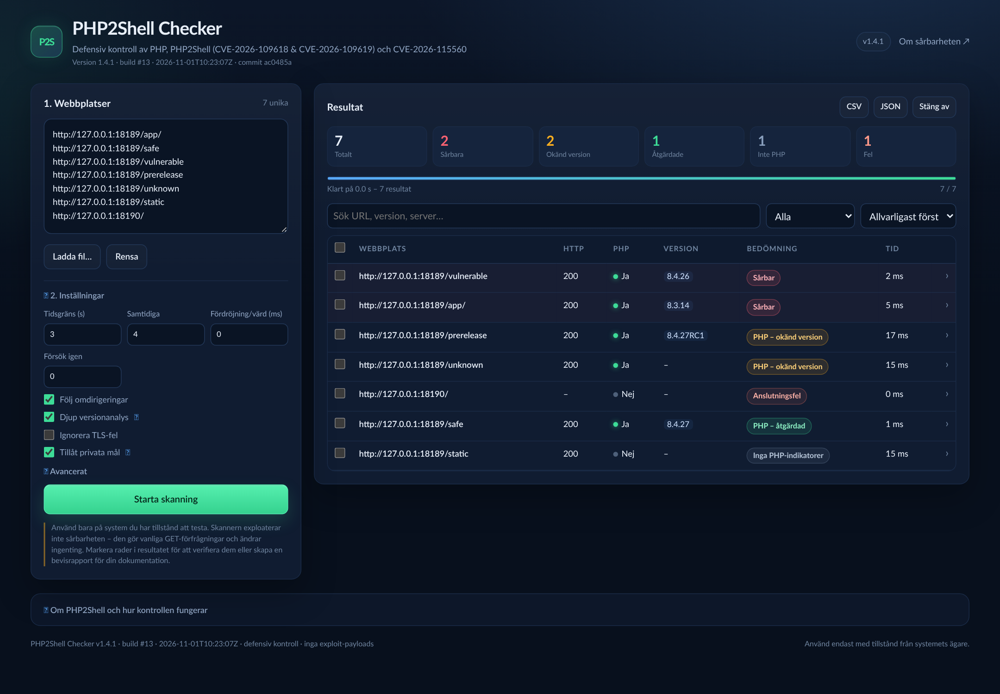
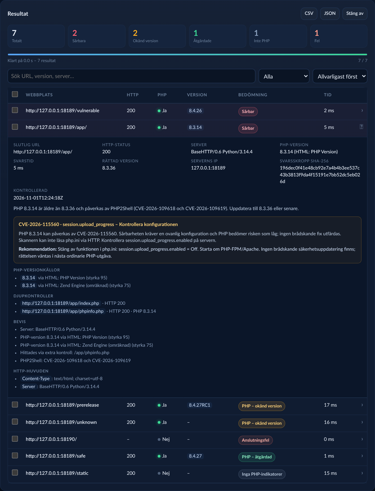

# PHP2Shell Checker

En snabb, defensiv skanner med grafiskt gränssnitt för att kontrollera om en webbplats använder PHP, göra en djup versionanalys och avgöra om PHP-versionen påverkas av **PHP2Shell** (CVE-2026-109618 och CVE-2026-109619). Skannern flaggar även **CVE-2026-115560** (`session.upload_progress`) som en separat rekommendation.

Skannern finns som fristående filer:

| Plattform | Fil |
| --- | --- |
| Windows 64-bit (rekommenderas) | [`release/PHP2Shell-Checker-Windows-x64.zip`](release/PHP2Shell-Checker-Windows-x64.zip) |
| Windows 64-bit (endast programmet) | [`release/PHP2Shell-Checker-Windows-x64.exe`](release/PHP2Shell-Checker-Windows-x64.exe) |
| Linux 64-bit | [`release/PHP2Shell-Checker-Linux-x64`](release/PHP2Shell-Checker-Linux-x64) |

Ingen Python-, Java- eller Go-installation behövs för att köra filerna.

Mer dokumentation: [lokal API](docs/API.md) · [Windows-felsökning](docs/WINDOWS_TROUBLESHOOTING.md) · [code signing](docs/CODE_SIGNING.md) · [supply chain](docs/SUPPLY_CHAIN.md) · [ändringslogg](CHANGELOG.md) · [säkerhetspolicy](SECURITY.md) · [utveckling](CONTRIBUTING.md) · [MIT-licens](LICENSE) · [tredjepartsnotiser](THIRD_PARTY_NOTICES).

## Kom igång på 2 minuter

1. Ladda ner filen för din plattform från tabellen ovan.
2. Starta programmet:
   - **Windows:** extrahera ZIP-filen och dubbelklicka på
     `PHP2Shell-Checker-Windows-x64.exe`.
   - **Linux:**
     ```bash
     chmod +x release/PHP2Shell-Checker-Linux-x64
     ./release/PHP2Shell-Checker-Linux-x64
     ```
3. Klistra in en eller flera webbadresser i textrutan och klicka på
   **Starta skanning**. Standardinställningarna fungerar för de flesta.
4. Klicka på en resultatrad för att se bevis och rekommendation. Markera rader
   om du vill skapa en bevisrapport.

Ingen installation, inget konto och ingen molntjänst behövs. Programmet körs
lokalt och öppnar sitt gränssnitt i webbläsaren.

> Ska du skanna interna system? Aktivera **Tillåt privata mål** och kontrollera
> först att du har uttryckligt tillstånd.

> Problem på Windows? Se [Windows-felsökning](docs/WINDOWS_TROUBLESHOOTING.md).

## Skärmbilder





Bilderna visar exempeldata från lokala testsidor. Verktyget visar version,
buildnummer, byggtid och källcommit längst upp i gränssnittet.

Nedan finns detaljerade plattformsinstruktioner, inställningar, bedömningar,
begränsningar och utvecklarinformation.

## Plattformsspecifikt

### Windows

1. Ladda ner `release/PHP2Shell-Checker-Windows-x64.zip`.
2. Högerklicka på ZIP-filen och välj **Extrahera alla…**. Kör sedan `.exe`-filen från den extraherade mappen – inte direkt inifrån ZIP-filen.
3. Ett konsolfönster öppnas och webbläsaren startar gränssnittet automatiskt.
4. Om webbläsaren inte öppnas: öppna adressen som står i konsolfönstret.
5. Stäng av med knappen **Stäng av** i gränssnittet eller genom att stänga konsolfönstret.

> SmartScreen, antivirus, EDR eller fel om skadad fil? Se [Windows-felsökning](docs/WINDOWS_TROUBLESHOOTING.md).

### Linux

```bash
chmod +x release/PHP2Shell-Checker-Linux-x64
./release/PHP2Shell-Checker-Linux-x64
```

Webbläsaren öppnas automatiskt. Om det inte fungerar, öppna adressen som skrivs ut i terminalen. Använd `--no-browser` för att bara starta servern:

```bash
./release/PHP2Shell-Checker-Linux-x64 --no-browser
```

Stäng av med **Stäng av** i gränssnittet eller `Ctrl+C` i terminalen.

### Kommandoradsflaggor

| Flagga | Beskrivning |
| --- | --- |
| `--port N` | Använd en fast lokal port. Standard är en slumpmässig ledig port. |
| `--no-browser` | Starta bara servern och öppna inte webbläsaren. |
| `--version` | Skriv ut version och avsluta. |
| `--help` | Visa tillgängliga flaggor. |

## Användning

1. Ange en eller flera webbplatser i textrutan, en per rad:
   ```text
   https://example.com
   example.org
   https://butik.example.se
   ```
2. Eller klicka på **Ladda fil…** och välj en `.txt`/`.csv`-fil med en adress per rad. Du kan också släppa filen direkt i textrutan.
3. Justera inställningarna vid behov och klicka på **Starta skanning**.
4. Resultaten visas direkt allt eftersom skanningen pågår. Klicka på en rad för att se bevis, HTTP-huvuden, PHP-version och rekommendation.
5. Markera raderna för de värdar du vill följa upp. Verktygsfältet **Valda värdar** blir då synligt.
6. **Verifiera valda** gör om kontrollen för de markerade värdarna med nya GET-förfrågningar och uppdaterar bevisen (IP-adress, tidsstämpel och fingeravtryck).
7. **Bevisrapport (HTML)** skapar en utskriftsvänlig rapport med sammanfattning, metod, fynd, rekommendationer och signaturfält. **Bevisrapport (JSON)** ger samma underlag i maskinläsbar form.
8. Exportera alla resultat som **CSV** eller **JSON**. Exporten omfattar alltid hela resultatlistan, oavsett vilket filter eller vilken sökning som är aktiv.

Rader som börjar med `#` eller `;` ignoreras. Adresser utan `http://` eller `https://` testas först med HTTPS och därefter med HTTP om HTTPS inte kan ansluta.

Längst upp i gränssnittet visas version, buildnummer, byggtid och källcommit.

### Inställningar

| Inställning | Standard | Beskrivning |
| --- | --- | --- |
| Tidsgräns | 10 s | Maximal tid per webbplats. |
| Samtidiga | 5 | Antal webbplatser som skannas parallellt. |
| Fördröjning/värd | 250 ms | Minsta tid mellan anrop till samma värd. |
| Försök igen | 2 | Antal extra försök vid HTTP 429/503. Följer `Retry-After` (max 30 s) och använder exponentiell backoff (500 ms–10 s). |
| Följ omdirigeringar | På | Följer upp till 6 omdirigeringar. |
| Djup versionanalys | På | Kombinerar PHP-indikatorer från cookies med versioner från svarshuvuden, HTML, phpinfo-liknande sidor och flera vanliga diagnostiksökvägar. Provar även webbplatsens rot om den aktuella katalogen inte ger en fullständig version. Stoppar så snart en fullständig version hittats, men kan innebära fler anrop och längre skanningstid. |
| Ignorera TLS-fel | Av | Användbart för servrar med trasiga eller självsignerade certifikat. |
| Tillåt privata mål | Av | Tillåter loopback, RFC1918, link-local, metadata och reserverade nät. Krävs för interna system. |
| User-Agent | `PHP2ShellChecker/1.4.1 …` | Kan ändras om en sajt blockerar skannern. |
| Proxy | Systemets inställning | `http://`, `https://`, `direct`, `none`, `env` eller tom. |
| Egna headers/cookies | Tomt | Skickas med varje GET-förfrågan. Reserverade hop-by-hop-headers filtreras bort. |

Headers, cookies och proxy-URL sparas inte i webbläsarens `localStorage`, eftersom de kan innehålla autentiseringsuppgifter.

Privata, lokala och reserverade mål blockeras som standard, även vid
omdirigering. Aktivera **Tillåt privata mål** endast för interna system som du
har uttryckligt tillstånd att skanna.

## Bedömningar

| Bedömning | Betydelse |
| --- | --- |
| **Sårbar** | PHP-versionen är äldre än den rättade versionen i samma gren. |
| **Sårbar – EOL** | PHP 8.1 eller äldre. Ingen officiell binär release finns; PHP tillhandahåller källbackporter för 7.4–8.1, i övriga fall krävs leverantörsbackport. |
| **PHP – okänd version** | PHP upptäcktes, men versionen kunde inte fastställas. Sårbarheten kan inte uteslutas. |
| **PHP – åtgärdad** | PHP-versionen är samma som eller nyare än den rättade versionen. |
| **Inga PHP-indikatorer** | Inga tydliga PHP-tecken hittades. Det utesluter inte PHP bakom CDN, WAF eller ett dolt gränssnitt. |
| **Anslutningsfel / Ogiltig URL** | Kontrollen kunde inte genomföras. |

### Rättade PHP-versioner

PHP2Shell påverkar PHP 5.4 och senare. Följande versioner innehåller rättelserna:

- PHP **8.5.12** eller senare
- PHP **8.4.27** eller senare
- PHP **8.3.36** eller senare
- PHP **8.2.35** eller senare
- PHP 8.1 och äldre: end-of-life. PHP-projektet har publicerat källbackporter för 7.4, 8.0 och 8.1; äldre grenar kräver leverantörsbackport.

Förhandsversioner och utvecklingsbyggen (`RC`, `beta`, `alpha`, `dev`, `snapshot` och `preview`) behandlas som **PHP – okänd version** eftersom de inte kan antas innehålla den slutliga säkerhetsrättelsen.

### CVE-2026-115560 och session.upload_progress

Två dagar efter PHP2Shell-fixarna varnade PHP för ytterligare ett sätt att köra kod: **CVE-2026-115560**. Det påverkar bara webbappar som är konfigurerade på ett ovanligt sätt: applikationen måste sätta `session.serialize_handler` till `php_binary` eller `php_serialize` och sedan byta till `php` i runtime med `ini_set()` före `session_start()`, samtidigt som `session.upload_progress` är aktiverat. PHP bedömer risken som låg. Ingen brådskande fix utfärdas; rättelsen väntas i nästa ordinarie PHP-utgåva.

Rekommendationen är att stänga av funktionen tills dess:

```ini
session.upload_progress.enabled = Off
```

Starta om PHP-FPM/Apache efter ändringen. Kontrollen är separat från PHP2Shell-bedömningen: en sajt kan vara **PHP – åtgärdad** för PHP2Shell och ändå få en påminnelse om `session.upload_progress`.

Eftersom `php.ini` inte kan läsas över HTTP är kontrollen en heuristik:

- **Kontrollera konfigurationen** visas när PHP upptäcks.
- **Möjligen påverkad – kontrollera** visas när sajten dessutom använder en PHP-sessionscookie och har filuppladdning i HTML-svaret. Det är en indikator, inte ett bevis på att applikationen byter `session.serialize_handler` i runtime.

Skannern skickar inga uppladdningar och ändrar inget. Verifiera alltid `session.upload_progress.enabled` på servern.

## Hur kontrollen går till

Skannern är **icke-invasiv** och skickar inga exploit-payloads. Den gör vanliga `GET`-förfrågningar och letar efter PHP-indikatorer:

- HTTP-huvuden som `X-Powered-By: PHP/8.4.26`, `X-PHP-Version`, `X-PHP-Engine`, `X-Server-Powered-By`, `X-Backend-Server` och `Server`.
- Cookies som `PHPSESSID`, `laravel_session`, `ci_session` med flera.
- HTML-referenser till `.php`-filer.
- PHP-felmeddelanden i svaret.
- PHP-version i HTML, inklusive `PHP Version`, `Powered by PHP`, `PHP/8.x`, meta generator, `PHP_VERSION`, JSON-fält och Zend OPcache.
- **Zend Engine-versionen räknas om till rätt PHP-gren** (Zend 4.3.x = PHP 8.3.x, Zend 3.4.x = PHP 7.4.x, Zend 2.6.x = PHP 5.6.x) i stället för att felaktigt tolkas som en PHP-version.
- Alla versionsobservationer sparas som kandidater med källa och styrka. Den mest tillförlitliga källan vinner, men en något svagare källa får komplettera en ofullständig version som `8.4` med exakt patchversion.
- Kända PHP-applikationer som WordPress, Drupal, Joomla, Magento, Laravel och Nextcloud.
- PHP-sessionscookies och filuppladdningsformulär, som underlag för CVE-2026-115560-rekommendationen.
- Med **Djup versionanalys**, när huvudsvaret inte ger en fullständig version, även `index.php`, `phpinfo.php`, `info.php`, `php-info.php`, `phpversion.php`, `test.php` och en slumpmässig `.php`-kontroll i samma katalog. Hittas ingen fullständig version provas samma sökvägar i webbplatsens rot. Alla kontroller loggas i resultatet med URL, HTTP-status och eventuell version.

Om en PHP-version hittas jämförs den med de rättade versionerna ovan. Skannern försöker aldrig utnyttja sårbarheten, ladda upp filer eller ändra något på servern.

## Bevis och rapportering

Resultatlistan kan användas som underlag i en utredning eller för rapportering till säkerhetsledningen:

- **Markera värdar** med kryssrutorna (eller kryssrutan i tabellhuvudet för alla synliga rader). Markeringen behålls när du filtrerar och sorterar.
- **Verifiera valda** kör om den vanliga, icke-invasiva kontrollen för de markerade värdarna och ersätter raderna med färska bevis. Varje resultat innehåller då även vilken IP-adress som svarade, ett SHA-256-fingeravtryck på de första 2 MiB av HTTP-svarskroppen, ett urval av svarshuvuden, alla PHP-versionkandidater med källa/styrka och loggen över djupkontrollerna.
- **Bevisrapport (HTML)** genererar en fristående, utskriftsvänlig rapport med sammanfattning, metodbeskrivning, avgränsning, per-värd-fynd, versionkällor, djupkontroller, rekommendationer och signaturfält. Öppna filen i en webbläsare och skriv ut eller spara som PDF.
- **Bevisrapport (JSON)** ger samma urval i maskinläsbar form för ärendehantering eller vidare bearbetning.

Rapporterna beskriver uttryckligen att kontrollen är icke-invasiv: inga exploit-payloads skickas, inga filer laddas upp och ingen åtkomst etableras. Ett fynd är en indikation på sårbar PHP-version, inte ett bevis på att sårbarheten är utnyttjad.

## Begränsningar

- En webbplats kan använda PHP utan att avslöja versionen. Då visas **PHP – okänd version**.
- CDN-tjänster, WAF:er och anpassade felsidor kan dölja både PHP och versionsinformation.
- En webbplats kan ligga bakom en reverse proxy där PHP körs på en annan server.
- Resultatet är en indikation, inte en garanti. Verifiera alltid mot serverns pakethanterare, kontrollpanel eller hostingleverantör.
- PHP2Shell är en sårbarhet i PHP-motorn. Att uppdatera applikationen, temat eller CMS:et räcker inte – PHP måste uppdateras.

## Säkerhet och etik

- Använd skannern **endast** på system som du äger eller har uttryckligt tillstånd att testa.
- Privata, lokala och reserverade mål blockeras som standard, även vid omdirigering. **Tillåt privata mål** kräver uttryckligt tillstånd för de interna systemen.
- Den lokala servern lyssnar bara på `127.0.0.1` och skyddas av en slumpmässig token per start.
- Inga resultat eller webbplatser skickas till tredje part.
- Skannern är avsedd för defensiv kontroll och inventering.

## Bygga från källkod

Kräver [Go](https://go.dev/) 1.27.3 eller senare samt `zip`, `unzip`, `gzip`, `base64` och `sha256sum` för releasebygget.

```bash
./build.sh
```

Skriptet bygger båda filerna till `release/`, paketerar Windowsversionen som ZIP, skapar en base64-kodad reservfil och skriver `SHA256SUMS.txt`. På Windows kan `build-windows.bat` användas för att bygga och paketera Windowsversionen.

Manuell build:

```bash
CGO_ENABLED=0 GOOS=linux GOARCH=amd64 go build -trimpath -buildvcs=false -ldflags "-s -w" \
  -o release/PHP2Shell-Checker-Linux-x64 .

CGO_ENABLED=0 GOOS=windows GOARCH=amd64 go build -trimpath -buildvcs=false -ldflags "-s -w" \
  -o release/PHP2Shell-Checker-Windows-x64.exe .
```

`-buildvcs=false` tar bort VCS-beroende från binären. `build.sh` injicerar
buildnummer, byggtid och källcommit så att de visas i gränssnittet. Sätt
`SOURCE_DATE_EPOCH` för en reproducerbar byggtid. En manuell `go build` utan
dessa `-ldflags` visar `development`, `dev` och `unknown` som buildinfo.

Kör tester:

```bash
go test ./...
```

Verifiera att `release/`-paketet är intakt och att version, storlek och
kontrollsummor stämmer:

```bash
./verify-release.sh
```

Kör worst-case-prestandatestet för 10 000 mål med djupanalys:

```bash
go test -run '^$' -bench BenchmarkWorstCase10000TargetsDeepCheck -benchtime=1x
```

CI kör formatering, `go vet`, race-tester, `staticcheck`, `govulncheck`,
korsbygge och release-verifiering vid varje push och pull request.

## Projektstruktur

```text
.
├── main.go                 # Startar lokal server och webbläsare
├── server.go               # HTTP-server, token-skydd och streaming-API
├── scanner.go              # Icke-invasiv PHP-detektering och djup versionanalys
├── advisory.go             # CVE-2026-115560 och session.upload_progress
├── version.go              # Jämförelse mot rättade PHP-versioner
├── fuzz_test.go            # Fuzz-tester för parser och analys
├── benchmark_test.go       # Prestandatest för 10 000 mål med djupanalys
├── web/index.html          # Grafiskt gränssnitt (HTML/CSS/JS)
├── build.sh                # Bygger Linux + Windows, ZIP och kontrollsummor
├── build-windows.bat       # Bygger Windows lokalt
├── verify-release.sh       # Verifierar release-paketet
├── sign-windows.ps1        # Authenticode-signering av Windows-EXE
├── docs/API.md             # Dokumentation för det lokala API:et
├── docs/CODE_SIGNING.md    # Code signing, certifikat och EDR
├── docs/WINDOWS_TROUBLESHOOTING.md # SmartScreen, EDR och skadade filer
├── docs/SUPPLY_CHAIN.md    # Branch protection, SBOM och releaseprovenance
├── docs/images/            # Skärmbilder för README
├── .github/workflows/      # CI: test, statisk analys och korsbygge
├── CHANGELOG.md            # Versionshistorik
├── SECURITY.md             # Säkerhetspolicy och rapportering
├── CONTRIBUTING.md         # Utveckling och releaseprocess
├── LICENSE                 # MIT-licens
├── THIRD_PARTY_NOTICES     # Go-runtimens BSD-licens
├── examples/               # Exempellista
└── release/                # Färdiga, startbara filer
```

## Referenser

- [NCSC-NL: php2shell](https://github.com/NCSC-NL/php2shell)
- [PHP:s säkerhetsadvisory (2026-10-21)](https://www.php.net/archive/2026.php#2026-10-21-5)
- [CERT-EU Security Advisory 2026-018](https://cert.europa.eu/publications/security-advisories/2026-018/)
- [Sansec: PHP2Shell](https://sansec.io/research/php2shell)
- [Wiz: PHP2Shell](https://www.wiz.io/blog/php2shell-php-rce)

## Licens

Projektet är licensierat under [MIT](LICENSE). Go-runtime och standardbibliotek
omfattas av Go-projektets BSD-licens; se [THIRD_PARTY_NOTICES](THIRD_PARTY_NOTICES).
